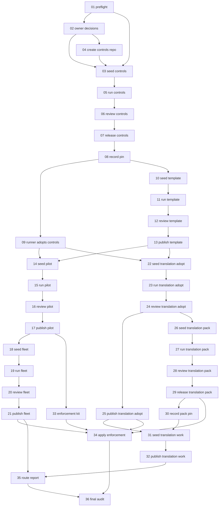

# Plan: shared deterministic controls, routed work, and a parallel translation plan

This file is the high-level plan. The detail is in `steps/` and `child-specs/`.

## Approach

The source is the deterministic-controls implementation plan of 2026-11-23 (phases 0 to 17). The [runner-routing](../runner-routing/plan.md) plan did phase 0 and the runner parts of phases 6, 14 and 15. This plan does the rest. It needs these runner features: operator and script steps, per-step agents, gates read from the plan branch, `touches` enforcement, `lib/fanout.py` and `lib/report.py`. Step 01 checks them.

**Parent and children.** The driver works on one repository. Work in other repositories runs as child plans. A seed step in this plan writes a child plan under `seeds/<wave>/` from a [child spec](./child-specs/). An operator step provisions and runs the wave with `lib/fanout.py`. Its gate is `fanout.py verify`. A review step checks the results and writes `lessons/<wave>.md`. An operator step merges the child branches. Its gate is `fanout.py published`. The next seed step reads all lessons first.

**Executors.** Each step names its executor in front matter. Seeds and reviews use a cloud agent (default `--agent`). Recording a pin and building the route report are `script` steps. Approvals, repository creation, dispatch, merges, releases and GitHub settings are `operator` steps. Child plans use `script` for audits and imports and a cloud agent for everything else (`tier: light` for small edits). The local model is not used after the bootstrap wave (owner decision 2026-11-23: too slow on this host). The policy is in `docs/routing.md` (written by `runner-routing`).

**Incremental value.** Each wave gives the next wave something:

| Wave | Gives the next waves |
| --- | --- |
| Controls library `v0.1.0` | One tested implementation of the context checks, a result contract and the adoption tools (audit, dry-run, apply, receipt). |
| Runner and template | Every new repository and every Ralph run gets pinned controls. The template carries the routing fields and the agent rules. |
| Translation adoption | The highest-value project leaves its private loop. It gets the template, CI controls and a Batch API path. It runs in parallel with the pilot. |
| Pilot (2 repositories) | Real compatibility defects found while the cost is small. A tested adoption recipe. |
| Fleet (8 repositories) | Broad coverage with the tested recipe, on cloud-agent and `script` routes. |
| Translation pack `v0.2.0` | Generic translation checks from the translation tools, available to all repositories. |
| Enforcement | Required checks and bypass probes, only after the pilot showed stable behavior. |

## Steps

| Step | Executor | Goal | Depends on |
| --- | --- | --- | --- |
| [01-preflight](./steps/01-preflight.md) | agent, light | Check the runner features, the baseline and the drift since it. | none |
| [02-owner-decisions](./steps/02-owner-decisions.md) | operator | Approve the owner decisions. | 01 |
| [03-seed-controls](./steps/03-seed-controls.md) | agent | Write the seed for the `controls` wave. | 01, 02, 04 |
| [04-create-controls-repo](./steps/04-create-controls-repo.md) | operator | Create the library repository from the template. | 02 |
| [05-run-controls](./steps/05-run-controls.md) | operator | Run the `controls` wave. | 03 |
| [06-review-controls](./steps/06-review-controls.md) | agent | Review the `controls` wave and write its lessons. | 05 |
| [07-release-controls](./steps/07-release-controls.md) | operator | Merge the library and tag v0.1.0. | 06 |
| [08-record-pin](./steps/08-record-pin.md) | script | Record the v0.1.0 commit in pins.tsv. | 07 |
| [09-runner-adopts-controls](./steps/09-runner-adopts-controls.md) | agent | Wire ralph-looper to the pinned library. | 08 |
| [10-seed-template](./steps/10-seed-template.md) | agent | Write the seed for the `template` wave. | 08 |
| [11-run-template](./steps/11-run-template.md) | operator | Run the `template` wave. | 10 |
| [12-review-template](./steps/12-review-template.md) | agent | Review the `template` wave and write its lessons. | 11 |
| [13-publish-template](./steps/13-publish-template.md) | operator | Merge the `template` results. | 12 |
| [14-seed-pilot](./steps/14-seed-pilot.md) | agent | Write the seed for the `pilot` wave. | 09, 13 |
| [15-run-pilot](./steps/15-run-pilot.md) | operator | Run the `pilot` wave. | 14 |
| [16-review-pilot](./steps/16-review-pilot.md) | agent | Review the `pilot` wave and write its lessons. | 15 |
| [17-publish-pilot](./steps/17-publish-pilot.md) | operator | Merge the `pilot` results. | 16 |
| [18-seed-fleet](./steps/18-seed-fleet.md) | agent | Write the seed for the `fleet` wave. | 17 |
| [19-run-fleet](./steps/19-run-fleet.md) | operator | Run the `fleet` wave. | 18 |
| [20-review-fleet](./steps/20-review-fleet.md) | agent | Review the `fleet` wave and write its lessons. | 19 |
| [21-publish-fleet](./steps/21-publish-fleet.md) | operator | Merge the `fleet` results. | 20 |
| [22-seed-translation-adopt](./steps/22-seed-translation-adopt.md) | agent | Write the seed for the `translation-adopt` wave. | 09, 13 |
| [23-run-translation-adopt](./steps/23-run-translation-adopt.md) | operator | Run the `translation-adopt` wave. | 22 |
| [24-review-translation-adopt](./steps/24-review-translation-adopt.md) | agent | Review the `translation-adopt` wave and write its lessons. | 23 |
| [25-publish-translation-adopt](./steps/25-publish-translation-adopt.md) | operator | Merge the `translation-adopt` results. | 24 |
| [26-seed-translation-pack](./steps/26-seed-translation-pack.md) | agent | Write the seed for the `translation-pack` wave. | 24 |
| [27-run-translation-pack](./steps/27-run-translation-pack.md) | operator | Run the `translation-pack` wave. | 26 |
| [28-review-translation-pack](./steps/28-review-translation-pack.md) | agent | Review the `translation-pack` wave and write its lessons. | 27 |
| [29-release-translation-pack](./steps/29-release-translation-pack.md) | operator | Merge the pack and tag v0.2.0. | 28 |
| [30-record-pack-pin](./steps/30-record-pack-pin.md) | script | Record the v0.2.0 commit in pins.tsv. | 29 |
| [31-seed-translation-work](./steps/31-seed-translation-work.md) | agent | Write the seed for the `translation-work` wave. | 25, 30 |
| [32-publish-translation-work](./steps/32-publish-translation-work.md) | operator | Provision and merge the v4-es-1 plan (do not run it). | 31 |
| [33-enforcement-kit](./steps/33-enforcement-kit.md) | agent | Write the protection checklist and the bypass probes. | 17 |
| [34-apply-enforcement](./steps/34-apply-enforcement.md) | operator | Apply the protection and run the bypass probes. | 21, 25, 29, 33 |
| [35-route-report](./steps/35-route-report.md) | script | Write the route report for the program. | 21, 32 |
| [36-final-audit](./steps/36-final-audit.md) | agent | Audit the program and write the backlog. | 34, 35 |

## Dependency graph



## Run it

Use a Bash host with Git, Python 3.11 or later, Docker (with FUSE for the two filesystem repositories), `gh` signed in as the repository owner, and the agent CLIs. The local model route is off for this program (`local_route` in `decisions.tsv`).

Start after `runner-routing` is merged into `main`. Export these absolute paths. Keep them the same on every restart.

- `RALPH_REPO`: the `ralph-looper` checkout on `main`.
- `REPOS_ROOT`: the parent directory of all repository checkouts.
- `RALPH_WORK`: the runtime directory, outside all repositories.

```bash
export RALPH_REPO REPOS_ROOT RALPH_WORK
"$RALPH_REPO/ralph-looper" --repo "$RALPH_REPO" --plan controls-rollout \
  --agent "$RALPH_AGENT" --jobs 3 --on-limit handoff
```

The driver exits `12` when it waits for an operator step. It prints the step name. Open that step file, do the action, and run the same command again. The driver checks the operator gate and continues. You never edit a step file to mark an operator step done.

Operator steps that run a wave use the plan worktree, because the seeds exist only on the plan branch until this plan merges:

```bash
plan_dir="$RALPH_WORK/ralph-looper/controls-rollout/worktrees/_plan/plans/controls-rollout"
python3 "$RALPH_REPO/lib/fanout.py" run --plan-dir "$plan_dir" --wave <wave> \
  --agent "$RALPH_CHILD_AGENT" --jobs <n>
```

Back up the plan branch with `ralph-pusher` if you want. Merge `plan/controls-rollout` into `main` through a pull request at any operator checkpoint. Merge it at the end in all cases.

## Parallelism

- 01 runs first, so that an old driver can never start an operator step. Then 02 and 04 (operator). 03 waits for 04 because `fanout.py ready` needs the new repository.
- After 08: 09 (this repository) and 10 (template seed) run together.
- After 13: the pilot lane (14 to 17) and the translation lane (22 to 25) run together. After 24, the pack lane (26 to 30) runs together with them. The translation work seed (31) waits for the adoption merge (25) and the `v0.2.0` pin (30).
- 33 (enforcement kit) runs while the fleet lane (18 to 21) runs.
- In a wave, `fanout.py run --jobs` runs the children together. Each child has its own repository, worktrees, Docker names and logs. Docker, FUSE and agent quota are shared host limits. Lower `--jobs` if they are not enough.
- Every step writes only its own files: its step file, its `seeds/<wave>/` tree or its `lessons/<wave>.md`. No two steps that can run together touch the same file.

## Risks

- **A seed is written before the facts are known.** Seeds are written one wave at a time, after the previous review. The lessons files carry the facts forward.
- **A shared release breaks many repositories.** Each repository pins an exact commit. Upgrades are reviewable pull requests. The pilot runs before the fleet. Every receipt records a rollback.
- **A secret is committed or pushed.** `runner-routing` builds a deterministic secret guard. Every child adds it in its first adoption commit as a required (not advisory) CI job and as pre-commit and pre-push hooks. The driver also runs it before each merge. A missed secret cannot be undone by a later fix, so this check skips the advisory phase.
- **The producing agent weakens a control.** The runner rejects edits to the gate and to files outside `touches`. CI runs the pinned controls. Step 33 adds required checks and review of policy files, and tests bypass attempts.
- **The platform cannot enforce a rule.** The translation repository is private. Branch protection on a private repository needs a paid GitHub plan. Step 33 records `documented-gap` with the reason. It does not claim enforcement that does not exist.
- **The translation loop is paused at a checkpoint.** `loop/STOP` stays in place. The adoption does not resume the old loop and does not change translated content, PO files or locked code. Jim decides when `v4-es-1` starts.
- **Batch output arrives late, twice or not at all.** Batch requests use stable `custom_id` values from segment ID and source hash. Import is idempotent. Unmatched or stale results are rejected.
- **The local model is too slow on this host.** The bootstrap wave measured it (three parallel steps, no edit in 70+ minutes). From then on, no step uses `agent: local` (`local_route` in `decisions.tsv`). The route report keeps the measurement.
